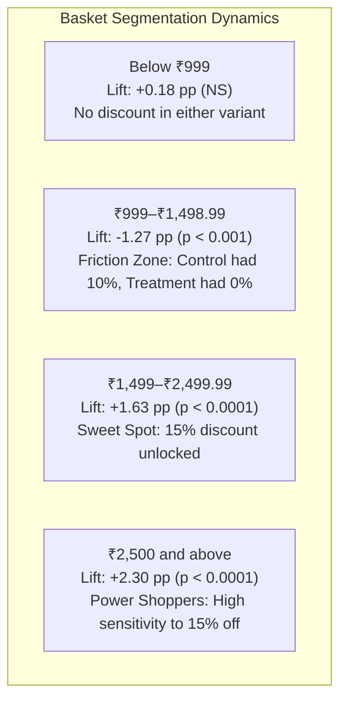

# Business Findings & Executive Decision Report

> [!IMPORTANT]
> **Synthetic Experiment Disclosure**: The analysis, figures, and business conclusions presented in this document are derived exclusively from a simulated, synthetic A/B test dataset (`N = 70,000`). They are created for educational and portfolio demonstration purposes and must not be cited as real-world consumer behavior or commercial results.

---

## 1. Executive Summary

We evaluated two competing promotional discount policies over a 28-day simulated experiment across 70,000 randomized e-commerce visitors:
- **Control (Variant A)**: 10% discount on a minimum pre-discount cart value of ₹999.
- **Treatment (Variant B)**: 15% discount on a minimum pre-discount cart value of ₹1,499.

### Core Recommendation: OUTCOME A — ADOPT TREATMENT B
Treatment B successfully satisfied all pre-registered statistical and commercial adoption criteria without breaching risk guardrails. The higher threshold paired with a deeper discount expanded order values and lifted total conversions sufficiently to overcome higher discount expenditure and variable costs, delivering incremental contribution profit.

| Key Metric | Control (A) | Treatment (B) | Absolute Difference ($\Delta$) | Relative Lift | Statistical & Decision Status |
| :--- | :--- | :--- | :--- | :--- | :--- |
| **Randomized Visitors (ITT)** | 35,000 | 35,000 | 0 | — | Perfect 1:1 balance (SRM $p = 1.0$) |
| **Purchase Conversion Rate** | 5.1057% (1,787) | 6.0314% (2,111) | **+0.9257 pp** | **+18.13%** | Significant ($p = 9.28 \times 10^{-8}$, Newcombe 95% CI: $[+0.59\text{ pp}, +1.27\text{ pp}]$) |
| **Gross AOV (Purchasers)** | ₹2,098.75 | ₹2,218.93 | **+₹120.18** | **+5.73%** | Significant (Bootstrap 95% CI: $[+₹58.05, +₹181.43]$) |
| **Net AOV (Purchasers)** | ₹1,893.95 | ₹1,920.55 | **+₹26.60** | **+1.40%** | Neutral / Preserved (95% CI: $[-₹26.51, +₹79.22]$) |
| **Retained Revenue (Total)** | ₹3,106,633.69 | ₹3,717,279.32 | **+₹610,645.63** | **+19.66%** | — |
| **Retained Revenue / Visitor** | ₹88.76 | ₹106.21 | **+₹17.45** | **+19.66%** | Significant (Bootstrap 95% CI: $[+₹10.66, +₹24.29]$) |
| **Contribution Profit (Total)**| ₹854,275.55 | ₹920,164.34 | **+₹65,888.79** | **+7.71%** | Incremental bottom-line gain |
| **Contribution Profit / Visitor**| ₹24.41 | ₹26.29 | **+₹1.88** | **+7.71%** | Significant (Bootstrap 95% CI: $[+₹0.0329, +₹3.7717]$) |
| **Purchaser Refund Rate** | 8.2261% (147) | 7.9583% (168) | **-0.2678 pp** | **-3.26%** | Guardrail satisfied (Upper CI: $+1.44\text{ pp} \le +3.00\text{ pp}$) |

---

## 2. Detailed Metric & Financial Breakdown

### A. Purchase Conversion & Top-Line Lift
- **Conversion Performance**: The Treatment policy generated **324 incremental purchasers** (2,111 vs. 1,787), representing an absolute conversion lift of **+0.9257 percentage points** (5.11% to 6.03%).
- **Practical Lift Evaluation**: The observed lift comfortably cleared the pre-experiment practical hurdle of $+0.50$ percentage points (+0.005), with the lower bound of the 95% Newcombe confidence interval ($+0.5861$ pp) sitting entirely above the threshold.

### B. Basket Economics & Discount Absorption
- **Gross Basket Expansion**: Purchasers in Treatment built carts that were on average **₹120.18 larger** (+5.73%) before discount than Control purchasers (₹2,218.93 vs. ₹2,098.75). Shoppers adjusted their baskets upward to clear the ₹1,499 qualification line.
- **Discount Concession**: Because Treatment offered a 15% discount (vs. 10%), total discount concessions grew by **₹263,907.35** (from ₹365,977.28 in Control to ₹629,884.63 in Treatment).
- **Net Price Realization**: Despite giving away 5 percentage points more in margin, the higher basket threshold successfully defended net order realization. Net AOV after discounts was **₹1,920.55 in Treatment vs. ₹1,893.95 in Control** (a slight gain of +₹26.60), confirming that the policy did not dilute order-level gross proceeds.

### C. Bottom-Line Contribution Profitability
A common risk with steeper discounts is "profitless volume," where extra orders fail to cover COGS, fulfillment, and marketing costs. In this simulated test:
1. **Gross Profit Impact**: Incremental retained revenue (+₹610,645.63) exceeded incremental product COGS (+₹510,240.89).
2. **Variable Operating Expenses**: Additional volume incurred higher outbound shipping (+₹19,440.00), gateway fees (+₹13,395.95), and return logistics (+₹1,680.00).
3. **Net Profitability**: Treatment generated **+₹65,888.79 in incremental contribution profit** (+7.71%). On an Intention-To-Treat per-visitor basis, contribution profit increased by **+₹1.88 per visitor** ($95\%\text{ CI: } [+₹0.0329, +₹3.7717]$). Because the lower confidence bound is strictly above ₹0, economic harm is ruled out with 95% statistical confidence.

### D. Refund Guardrail Compliance
- A major pre-experiment concern was whether customers forced into larger carts to unlock 15% off would experience "buyer's remorse" and initiate more product returns.
- **Observed Purchaser Refund Rate**: Control was $8.23\%$ and Treatment was $7.96\%$ (a difference of $-0.27$ pp).
- **Guardrail Decision**: The 95% confidence interval for the purchaser refund rate difference was **$[-2.01\text{ pp}, +1.44\text{ pp}]$**. The worst-case upper bound of $+1.44$ pp remained well below the pre-specified risk limit of $+3.00$ pp, successfully passing the safety guardrail.

---

## 3. Segment Dynamics & Nuanced Insights

Subgroup analysis revealed clear behavioral differences across customer and cart tiers:

### 1. The Mid-Basket "Friction Zone" (₹999 to ₹1,498.99)
- In the ₹999–₹1,498.99 band, Treatment conversion dropped significantly by **$-1.27$ percentage points** (from 4.81% in Control to 3.54% in Treatment, Holm-adjusted $p = 0.00025$).
- **Behavioral Driver**: Customers in this band qualified for 10% off under Control, but under Treatment they received 0% off unless they added at least ₹500 more of merchandise. A portion of price-sensitive shoppers refused to stretch and abandoned checkout.

### 2. High-Basket Surge (₹1,499+)
- In the ₹1,499–₹2,499.99 tier, conversion rose from 5.37% to 7.01% (**+1.63 pp**, Holm $p < 0.00001$).
- In the ₹2,500+ tier, conversion rose from 5.65% to 7.95% (**+2.30 pp**, Holm $p < 0.00001$).
- **Takeaway**: Once users crossed the threshold, the attractive 15% incentive dramatically increased purchase motivation, comfortably offsetting the attrition in the ₹999–₹1,498.99 band.

### 3. Returning vs. New Customers
- **Returning Customers**: Responded enthusiastically to Treatment, with conversion jumping from 5.28% to 7.15% (**+1.87 pp**, Holm $p < 0.00001$). Repeat buyers know the catalog well, find it easy to build larger carts, and recognize the value of a 15% discount.
- **New Customers**: Exhibited a modest lift from 5.01% to 5.43% (+0.42 pp, raw $p = 0.046$), which became non-significant after Holm-Bonferroni correction (adjusted $p = 0.186$).

### 4. Device Channels
- **Desktop Users**: Conversion rose by **+1.03 pp** (5.28% to 6.32%, Holm $p = 0.010$).
- **Mobile Users**: Conversion rose by **+0.90 pp** (4.98% to 5.88%, Holm $p = 0.00019$).
- **Tablet Users**: Lift was $+0.74$ pp (5.59% to 6.33%), but was not statistically significant due to smaller sample size ($n \approx 2,400$ per variant).

---

## 4. Final Recommendation & Implementation Roadmap

### Recommendation: Adopt Treatment B (15% off ₹1,499+)
The pre-registered decision rules dictate a clear **Outcome A (Adopt Treatment)**:
1. Two-sided conversion p-value $< 0.05$ ($9.28 \times 10^{-8}$) $\rightarrow$ **PASS**
2. Absolute conversion lift $\ge +0.005$ ($+0.009257$) $\rightarrow$ **PASS**
3. Profit delta lower bound $> ₹0$ ($+₹0.0329$) $\rightarrow$ **PASS**
4. Refund delta upper bound $\le +0.03$ ($+0.0144$) $\rightarrow$ **PASS**

### Operational Next Steps for Product & Merchandising
1. **Rollout Plan**: Transition storewide default promotion from 10% off ₹999 to 15% off ₹1,499.
2. **Friction Zone Mitigation**: In cart pages with values between ₹999 and ₹1,498, display an intelligent **progress bar** (*"Add ₹X more to get 15% off!"*) and dynamic cross-sell add-ons to prevent drop-off in this sensitive band.
3. **Targeted Campaigns**: Heavily promote the 15% offer in CRM and loyalty emails to returning customers, who exhibited the strongest affinity for the policy.
4. **Post-Rollout Monitoring**: Keep track of the purchaser refund rate over the first 60 days of full deployment to ensure the refund rate remains stable.
