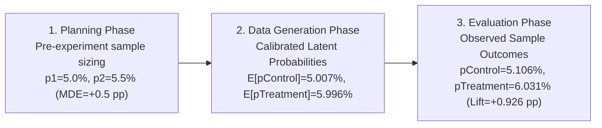
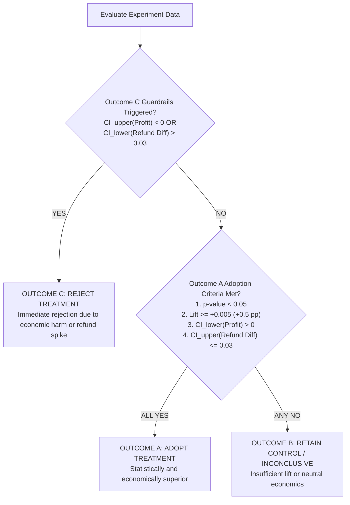

# Statistical Methodology & Experimentation Framework

> [!IMPORTANT]
> **Synthetic Experiment Disclosure**: All statistical models, calibrations, data generation, and hypothesis tests described herein were conducted using a synthetic simulation framework. No real customer or production data was utilized.

---

## 1. Distinction: Planning Targets vs. Calibrated Latent Probabilities vs. Observed Results

A core principle of rigorous experimentation is maintaining a clear distinction between three separate phases of the metric lifecycle:

1. **Pre-Experiment Planning Targets**:
   - Baseline Control Conversion ($p_1$): $5.0\%$ ($0.050$).
   - Treatment Planning Conversion ($p_2$): $5.5\%$ ($0.055$) — chosen as the Minimum Detectable Effect (MDE $= +0.5$ percentage points or Cohen's $h = 0.02242$) to power the study.
   - Purpose: Determine minimum sample size required before launching the experiment.

2. **Simulation Calibration Targets & Latent Probabilities**:
   - The simulation model was calibrated against target ground-truth benchmarks of $5.0\%$ for Control and $6.0\%$ for Treatment (reflecting a true latent underlying treatment effect of $+1.0$ pp).
   - Numerical least-squares optimization solved for the logit intercept ($\beta_0 = -3.179635$) and treatment sensitivity ($\Delta \beta = 0.322060$).
   - Across the 70,000 randomized users, the average realized latent purchase probability was **5.0067% for Control** and **5.9960% for Treatment**.

3. **Observed Empirical Results**:
   - Realized binary Bernoulli trial outcomes across the 70,000 users generated **1,787 purchasers out of 35,000 in Control (5.1057%)** and **2,111 purchasers out of 35,000 in Treatment (6.0314%)**.
   - The observed absolute conversion lift was **+0.9257 percentage points** (+18.13% relative lift), exhibiting natural random sampling variation around the 1.0 pp latent effect.

---

## 2. Pre-Experiment Power Analysis & Sample Size Planning

### Formulations & Parameters
- **Significance Level ($\alpha$)**: $0.05$ (two-sided, corresponding to critical value $Z_{\alpha/2} = 1.95996$).
- **Statistical Power ($1 - \beta$)**: $0.80$ ($80\%$ probability of rejecting the null hypothesis when a true effect of size MDE exists, corresponding to $Z_{\beta} = 0.84162$).
- **Allocation Ratio ($k$)**: $1:1$ ($n_1 = n_2$).

### Standardized Effect Size: Cohen's $h$
Cohen's $h$ measures the distance between two proportions on an arcsine square-root transformed scale:
$$h = 2 \cdot \arcsin\left(\sqrt{p_2}\right) - 2 \cdot \arcsin\left(\sqrt{p_1}\right)$$
For $p_1 = 0.050$ and $p_2 = 0.055$:
$$h = 2 \cdot \arcsin\left(\sqrt{0.055}\right) - 2 \cdot \arcsin\left(\sqrt{0.050}\right) \approx 0.02242$$

### Required Sample Size Calculation
Using the standard normal approximation for two independent proportions with pooled variance $\bar{p} = (p_1 + p_2)/2 = 0.0525$ and $q_1 = 1 - p_1$, $q_2 = 1 - p_2$:
$$n = \frac{\left(Z_{\alpha/2} \sqrt{2 \bar{p}(1 - \bar{p})} + Z_{\beta} \sqrt{p_1 q_1 + p_2 q_2}\right)^2}{(p_2 - p_1)^2}$$
- **Required sample size per group**: $31,218$ users.
- **Required total sample size**: $62,436$ users.
- **Locked Planned Sample Size**: Exactly **35,000 users per group** ($70,000$ total).
- **Achieved Nominal Statistical Power**: **84.29%** (exceeding the 80% planning hurdle, providing adequate buffer against variance).

---

## 3. Primary Hypothesis Testing: Two-Proportion Z-Test

### Hypotheses
- **Null Hypothesis ($H_0$)**: $p_{\text{Treatment}} - p_{\text{Control}} = 0$ (no difference in true purchase conversion rates).
- **Alternative Hypothesis ($H_1$)**: $p_{\text{Treatment}} - p_{\text{Control}} \ne 0$ (a two-sided non-zero difference exists).

### Test Statistic
Under the null hypothesis, the pooled conversion rate is:
$$\hat{p}_{\text{pool}} = \frac{x_1 + x_2}{n_1 + n_2} = \frac{1,787 + 2,111}{35,000 + 35,000} = \frac{3,898}{70,000} = 0.0556857$$
The standard error under $H_0$ is:
$$\text{SE}_{\text{pool}} = \sqrt{\hat{p}_{\text{pool}}(1 - \hat{p}_{\text{pool}})\left(\frac{1}{n_1} + \frac{1}{n_2}\right)} \approx 0.0017334$$
The two-proportion Z-statistic is:
$$Z = \frac{\hat{p}_{\text{Treatment}} - \hat{p}_{\text{Control}}}{\text{SE}_{\text{pool}}} = \frac{0.060314 - 0.051057}{0.0017334} = 5.3403 \quad (\text{or } -5.3403 \text{ when evaluated as Control - Treatment})$$
- **P-Value**: $p = 9.28 \times 10^{-8} < 0.0000001$.
- **Statistical Decision**: Reject $H_0$ at $\alpha = 0.05$. The conversion lift is highly statistically significant.

---

## 4. Conversion Effect Confidence Interval: Newcombe / Wilson Hybrid Method

Standard Wald intervals ($\hat{p}_2 - \hat{p}_1 \pm Z \sqrt{\frac{\hat{p}_1 q_1}{n_1} + \frac{\hat{p}_2 q_2}{n_2}}$) exhibit notorious coverage degradation when baseline conversion rates are low ($\approx 5\%$). Therefore, we locked the **Newcombe hybrid score interval** (based on Wilson score intervals for single proportions without continuity correction):

1. Compute Wilson score bounds $(L_1, U_1)$ for Control and $(L_2, U_2)$ for Treatment:
   $$w = \frac{\hat{p} + \frac{Z^2}{2n} \pm Z \sqrt{\frac{\hat{p}(1 - \hat{p})}{n} + \frac{Z^2}{4n^2}}}{1 + \frac{Z^2}{n}}$$
2. Combine into Newcombe difference bounds:
   $$\text{Lower} = (\hat{p}_2 - \hat{p}_1) - \sqrt{(\hat{p}_2 - L_2)^2 + (U_1 - \hat{p}_1)^2}$$
   $$\text{Upper} = (\hat{p}_2 - \hat{p}_1) + \sqrt{(U_2 - \hat{p}_2)^2 + (\hat{p}_1 - L_1)^2}$$

### Verified Results
- **Observed Conversion Difference**: $+0.9257$ percentage points ($+0.009257$).
- **95% Confidence Interval**: **$[+0.5861\text{ pp}, +1.2657\text{ pp}]$** ($[+0.005861, +0.012657]$).
- **Validation**: Zero is excluded from the interval, and the entire lower bound ($+0.5861$ pp) strictly exceeds the practical significance threshold ($+0.50$ pp).

---

## 5. Non-Parametric Bootstrap Methodology for Monetary Metrics

Continuous financial metrics (AOV, revenue per visitor, contribution profit per visitor) violate Gaussian normality due to extreme right-skewness and excess zeroes from non-purchasers ($> 94\%$). 

### Bootstrap Protocol
- **Replications**: Exactly $B = 10,000$ resamples.
- **Resampling Method**: Independent non-parametric resampling with replacement within each experiment group ($n_1 = 35,000$ from Control, $n_2 = 35,000$ from Treatment).
- **Random Seed**: Locked seed `2027` (using `np.random.PCG64(2027)`).
- **Interval Estimation**: Empirical percentile method:
  $$\text{CI}_{95\%} = \left[\hat{\theta}^*_{(0.025 \cdot B)}, \; \hat{\theta}^*_{(0.975 \cdot B)}\right]$$

### Verified 10,000-Replication Bootstrap Results
| Metric Difference ($\Delta = \text{Treatment} - \text{Control}$) | Point Estimate | 95% Bootstrap CI | Statistical Conclusion |
| :--- | :--- | :--- | :--- |
| **Retained Revenue per Visitor** | $+₹17.45$ | $[+₹10.66, \; +₹24.29]$ | Statistically significant positive lift |
| **Contribution Profit per Visitor** | $+₹1.88$ | $[+₹0.0329, \; +₹3.7717]$ | Statistically significant positive lift ($\text{Lower} > ₹0$) |
| **Gross AOV (among purchasers)** | $+₹120.18$ | $[+₹58.05, \; +₹181.43]$ | Statistically significant basket expansion |
| **Net AOV (among purchasers)** | $+₹26.60$ | $[-₹26.51, \; +₹79.22]$ | Neutral / non-significant after steeper discount |

---

## 6. Precedence-Ordered Decision Framework & Guardrails

The experiment governs policy adoption via a strict hierarchy where risk-mitigation guardrails take absolute precedence over conversion lift:

### Evaluation against Verified Data
1. **Outcome C Check (Evaluated First)**:
   - Profit upper bound $< ₹0$? Upper bound is $+₹3.7717 \ge 0$. $\rightarrow$ **False**
   - Refund difference lower bound $> 0.03$ ($+3$ pp)? Lower bound is $-2.0084\text{ pp} \le +3.0\text{ pp}$. $\rightarrow$ **False**
   - *Outcome C does not trigger.*
2. **Outcome A Check (Evaluated Second)**:
   - $p < 0.05$: $9.28 \times 10^{-8} < 0.05$ $\rightarrow$ **PASS**
   - Absolute conversion lift $\ge +0.005$: $+0.009257 \ge 0.005$ $\rightarrow$ **PASS**
   - Profit CI lower bound $> 0$: $+₹0.0329 > 0$ $\rightarrow$ **PASS**
   - Refund CI upper bound $\le 0.03$: $+0.014427 \le 0.0300$ $\rightarrow$ **PASS**
   - *All 4 criteria pass simultaneously.*
3. **Final Decision**: **OUTCOME A — Adopt Treatment Policy**.

---

## 7. Secondary Multivariate Analysis & Validation

### A. Sample Ratio Mismatch (SRM) & Balance
- **Observed Allocation**: Exactly 35,000 Control vs. 35,000 Treatment (1:1 split).
- **Goodness-of-Fit Test**: $\chi^2 = 0.0000$, $p = 1.000000$. No sample ratio mismatch detected.
- **Baseline Covariate Balance**: Absolute Standardized Mean Differences ($|\text{SMD}|$) for cart value, returning status, device types, and traffic sources were all $< 0.010$ (well below the $0.10$ threshold), demonstrating exemplary randomization.

### B. Segment-Level Hypothesis Testing with Holm-Bonferroni Correction
To control the Family-Wise Error Rate (FWER) across 12 subgroup hypotheses, the Holm step-down procedure adjusted raw p-values:
- **Basket Value Bands**:
  - `Below ₹999`: Lift $+0.18$ pp, Holm $p = 0.681$ (Not significant; neither variant offers a discount below ₹999).
  - `₹999–₹1,498.99`: Lift **$-1.27$ pp**, Holm $p = 0.00025$ (**Significant negative lift**; Control received 10% discount while Treatment required ₹1,499 so received 0% discount).
  - `₹1,499–₹2,499.99`: Lift **$+1.63$ pp**, Holm $p < 0.00001$ (**Significant positive lift**; Treatment received 15% discount vs Control 10%).
  - `₹2,500 and above`: Lift **$+2.30$ pp**, Holm $p < 0.00001$ (**Significant positive lift**; high willingness-to-pay shoppers highly incentivized by 15% discount).
- **Customer Lifecycle**:
  - `Returning`: Lift **$+1.87$ pp** (5.28% to 7.15%), Holm $p < 0.00001$ (**Significant**; repeat customers are highly responsive to threshold incentives).
  - `New`: Lift $+0.42$ pp (5.01% to 5.43%), raw $p = 0.046$, Holm $p = 0.186$ (**Not significant** after multiplicity correction).
- **Device & Traffic**:
  - Mobile ($+0.90$ pp) and Desktop ($+1.03$ pp) showed significant gains after Holm correction; Tablet ($+0.74$ pp) was underpowered.
  - Organic ($+1.11$ pp) and Paid ($+0.80$ pp) were significant; Email ($+0.92$ pp) was not significant after adjustment.

### C. Multivariable Logistic Regression
To confirm treatment efficacy after controlling for baseline covariates:
$$\text{logit}(P(\text{purchase} = 1)) = \beta_0 + \beta_{\text{treatment}} \cdot \text{Variant} + \beta_{\text{cart}} \cdot \ln(\text{cart\_val}/1800) + \beta_{\text{ret}} \cdot \text{Returning} + \mathbf{X}_{\text{device}} \boldsymbol{\beta}_{\text{dev}} + \mathbf{X}_{\text{traffic}} \boldsymbol{\beta}_{\text{traf}}$$
- **Treatment Coefficient ($\hat{\beta}$)**: $+0.1790$ ($SE = 0.0332$, $z = 5.385$, $p = 7.24 \times 10^{-8}$).
- **Adjusted Odds Ratio ($e^{\hat{\beta}}$)**: **$1.1960$** ($95\%\text{ CI: } [1.1208, 1.2762]$).
- **Interpretation**: Visitors assigned to Treatment B have **19.6% higher odds of completing a purchase** compared to Control, holding initial cart size, device, customer tenure, and traffic acquisition channel constant.
